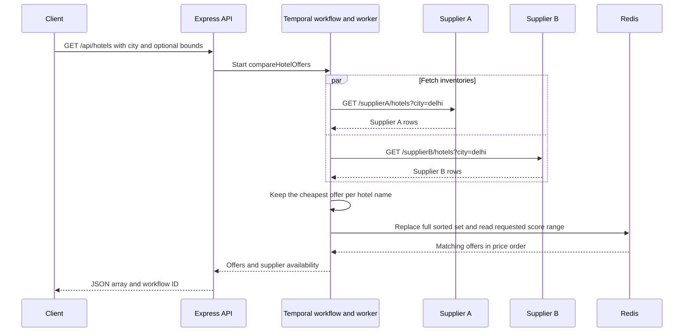

# Hotel Offer Orchestrator

One search returns the cheapest offer for each hotel in a city. In Delhi, Supplier B wins Holtin at **5,340** and Supplier A wins Radison at **5,900**. The response carries the commission from the winning offer.

**Node.js · TypeScript · Express · Temporal · Redis · Docker Compose**

[Quick start](#quick-start) · [API contract](#api-contract) · [Postman collection](postman/Hotel-Offer-Orchestrator.postman_collection.json) · [Deployment](#deploy-to-a-server) · [Assessment checklist](#assessment-checklist)

## Quick start

Install Docker with the Compose v2 plugin. Start the four services from the directory containing `compose.yaml`.

```sh
docker compose up --build -d --wait
docker compose ps
```

All four services should report `healthy`. The worker’s readiness probe checks that the worker is running and that both a Temporal RPC and a Redis ping succeed.

Open the [Delhi search](http://127.0.0.1:3000/api/hotels?city=delhi), [supplier health](http://127.0.0.1:3000/health), or [Temporal UI](http://127.0.0.1:8233). To reproduce the two rows in the assignment, open the [inclusive price range from 5,340 to 5,900](http://127.0.0.1:3000/api/hotels?city=delhi&minPrice=5340&maxPrice=5900).

```json
[
  { "name": "Holtin", "price": 5340, "supplier": "Supplier B", "commissionPct": 20 },
  { "name": "Radison", "price": 5900, "supplier": "Supplier A", "commissionPct": 13 }
]
```

## How a search works



Both mock endpoints run inside Express. Each valid search starts a new Temporal workflow. The worker executes the HTTP and Redis calls as activities. The workflow compares names after trimming, collapsing whitespace, folding to lowercase and applying Unicode NFC normalization. Two encodings of “Hôtel” match, while “Hotel” remains a separate name. The winning offer keeps its supplier’s spelling. Equal prices go to Supplier A, and a tie within one supplier keeps its first row.

### Delhi fixtures

| Hotel | Supplier A | Supplier B | Winning offer | Commission |
| --- | ---: | ---: | --- | ---: |
| Holtin | 6,000 | 5,340 | Supplier B | 20% |
| Radison | 5,900 | 6,400 | Supplier A | 13% |
| Neem Courtyard | 7,200 | — | Supplier A | 9% |
| Lotus Residency | — | 8,100 | Supplier B | 11% |

Mumbai includes a tie for Harbour House at 4,800. An unknown city such as `atlantis` returns `[]`.

One useful boundary case is [Delhi at exactly 6,000](http://127.0.0.1:3000/api/hotels?city=delhi&minPrice=6000&maxPrice=6000). The result is `[]`. Supplier A charges 6,000 for Holtin, but its offer has already lost to Supplier B's 5,340 before Redis evaluates the range.

## API contract

| Method and path | Result |
| --- | --- |
| `GET /api/hotels?city=delhi` | Deduplicated offers sorted by ascending price |
| `GET /api/hotels?city=delhi&minPrice=5340&maxPrice=5900` | Winners in the inclusive price range |
| `GET /supplierA/hotels` | Supplier A rows with `hotelId`, `name`, `price`, `city`, and `commissionPct` |
| `GET /supplierB/hotels` | Supplier B rows in the same format |
| `GET /health` | Live HTTP probe results for each supplier |

Both mock endpoints accept an optional `city`. Search requires one nonblank city of up to 80 characters. Prices accept non-negative decimal values, including zero. Either bound can be omitted. An empty range result is HTTP 200 with `[]`.

Each search that starts orchestration includes `X-Workflow-Id`. Paste its value into the Temporal UI to inspect activity schedules, retries, and the result. A partial success also includes `X-Unavailable-Suppliers`.

| Condition | HTTP | Response |
| --- | ---: | --- |
| Offers found, one or both suppliers responding | 200 | Array of winning offers |
| No matching offers | 200 | `[]` |
| Missing city, invalid number, repeated city/price, or reversed bounds | 400 | `INVALID_REQUEST` |
| Both suppliers failed | 503 | `SUPPLIERS_UNAVAILABLE` |
| Redis storage or range read failed | 503 | `STORAGE_UNAVAILABLE` |
| Temporal could not confirm the workflow start, or orchestration failed | 503 | `SEARCH_UNAVAILABLE` |
| A started search exceeded its deadline | 504 | `SEARCH_TIMEOUT` |

Errors include a machine-readable code and a message explaining the failure.

```json
{ "error": { "code": "INVALID_REQUEST", "message": "minPrice must be less than or equal to maxPrice." } }
```

### Inspect Redis

The worker writes the **full** deduplicated set before applying the requested price bounds. A member is the JSON offer and its score is the price. `DEL`, `ZADD`, `EXPIRE`, and `ZRANGEBYSCORE` run in one transaction so concurrent requests read their own writes. Each nonempty snapshot expires after ten minutes. An empty inventory clears its snapshot.

After a Delhi search, these commands show all four stored offers, the two offers in range, and the remaining snapshot lifetime.

```sh
docker compose exec redis redis-cli ZRANGE hotels:v1:delhi:A+B 0 -1 WITHSCORES
docker compose exec redis redis-cli ZRANGEBYSCORE hotels:v1:delhi:A+B 5340 5900
docker compose exec redis redis-cli TTL hotels:v1:delhi:A+B
```

The key suffix identifies the suppliers that responded. For example, `hotels:v1:delhi:A` holds a partial snapshot when B is down, and `hotels:v1:delhi:A+B` holds the complete snapshot. Every search refreshes its inventory from the suppliers. [Redis sorted sets](https://redis.io/docs/latest/data-types/sorted-sets/)

## Health, retries, and logs

`/health` calls both supplier listing endpoints in parallel with a two-second HTTP timeout. It can report supplier availability while Temporal or Redis is offline. Two successful probes return 200. A failed probe returns 503 and identifies the affected supplier. In this example, Supplier B is down.

```json
{
  "status": "degraded",
  "suppliers": {
    "Supplier A": { "status": "up", "latencyMs": 4 },
    "Supplier B": { "status": "down", "latencyMs": 5, "reason": "Supplier B returned HTTP 503" }
  }
}
```

Send `X-Mock-Outage: A`, `B`, or `both` on a search, health check, or direct supplier request. The chosen mock returns a real HTTP 503 for that request and its retries. Other clients continue to see normal inventory. On Windows PowerShell, use `curl.exe` for the commands below.

```sh
curl -i -H "X-Mock-Outage: B" "http://127.0.0.1:3000/health"
curl -i -H "X-Mock-Outage: B" "http://127.0.0.1:3000/api/hotels?city=delhi"
docker compose logs --tail=100 worker api
```

To observe recovery inside a single search, send `X-Mock-Outage: B-once` on the search endpoint. The worker uses Temporal's activity attempt number to trigger a real HTTP 503 from Supplier B only on its first call. On attempt two, B returns its normal inventory. The original HTTP response includes all four Delhi winners and omits `X-Unavailable-Suppliers`. Copy its `X-Workflow-Id` into Temporal UI to inspect the completed activity and its previous failure.

```sh
curl -i -H "X-Mock-Outage: B-once" "http://127.0.0.1:3000/api/hotels?city=delhi"
```

Temporal allows three attempts per activity with exponential backoff starting at 250 ms. Each attempt gets four seconds and each activity gets twelve seconds overall. The API gives Temporal three seconds to accept a workflow, so a stopped or unreachable Temporal fails fast with 503 `SEARCH_UNAVAILABLE` while `/health` and the supplier endpoints keep working. Once started, a workflow has thirty seconds to complete, and the API waits two seconds beyond that, so a slow search is reported as 504 `SEARCH_TIMEOUT` by the workflow's own limit. A failure to start is never a 504. Activity logs include supplier failures, attempt metadata, Redis keys, and row counts. Workflow logs record degraded results and terminal failures. [Temporal TypeScript guide](https://docs.temporal.io/develop/typescript)

## Run the tests

**Postman.** Import the [collection JSON](postman/Hotel-Offer-Orchestrator.postman_collection.json), keep the collection variable `baseUrl` at `http://127.0.0.1:3000`, and select **Run collection**. The 26 requests check both raw supplier APIs, overlapping and exclusive hotels, price boundaries, empty results, validation, each supplier failing separately, both failing together, and recovery. Newman runs the same collection from a terminal with Node.js.

```sh
npx --yes newman@6.2.1 run postman/Hotel-Offer-Orchestrator.postman_collection.json
```

**Unit tests.** With Node.js 22 or 24, run `npm ci` and `npm test`. This compiles TypeScript and tests comparison rules and input validation.

**Full-stack test.** Run this command against the active Compose stack.

```sh
docker compose run --rm --no-deps -v ./test:/app/test:ro worker npm run test:stack
```

The stack tests inspect Temporal history to verify parallel scheduling, retry exhaustion during a sustained outage, and successful recovery during a single search. They also read Redis directly to check scores, expiration, separate city snapshots, and removal of stale offers when a city’s inventory becomes empty.

**Dependency failure tests.** With a dedicated Compose stack running, run `npm run test:resilience`. The suite pauses Temporal, stops Redis, and stops the worker in separate cases. It checks readiness and the API’s 503 and 504 responses, then restores the affected service and confirms searches recover after each case. Set `COMPOSE_PROJECT_NAME` if you started the stack with a custom project name and `API_BASE_URL` if the API uses a custom origin.

After pushing the repository, open **Actions → Verify hotel offers** for the submitted commit. The workflow builds the project, checks supplier health before starting Temporal, and runs the unit, stack, Postman, and dependency failure tests. The run’s **postman-results** artifact contains the per-request JUnit report. [Verification workflow](.github/workflows/verify.yml)

To repeat the API checks against a deployed instance, replace the example origin with your public HTTPS origin.

```sh
npx --yes newman@6.2.1 run postman/Hotel-Offer-Orchestrator.postman_collection.json --env-var "baseUrl=https://your-host.example"
```

## Deploy to a server

1. On a Linux host with Docker Engine and the Compose v2 plugin, clone the project repository or copy the submission directory to the host. Enter the directory containing `compose.yaml`.
2. Run `docker compose config --quiet`, then `docker compose up --build -d --wait`. Compose starts Redis, Temporal, the API, and the worker. The API and worker use the multi-stage [Dockerfile](Dockerfile) and run as the unprivileged Node user.
3. On the host, run `curl -fsS http://127.0.0.1:3000/health` and `curl -fsS 'http://127.0.0.1:3000/api/hotels?city=delhi'`. The second request verifies that the worker and Redis can complete a search.
4. For a private review, run `ssh -L 3000:127.0.0.1:3000 -L 8233:127.0.0.1:8233 user@your-server` on your computer. Open the quick-start links or run Postman. For a shared URL, point the host's HTTPS reverse proxy at `127.0.0.1:3000` and set Postman's `baseUrl` to that URL.
5. To roll out a revision, update the source and rerun `docker compose up --build -d --wait`. To stop, run `docker compose down`. Named volumes retain Redis data and Temporal's SQLite workflow history between restarts.

Redis and Temporal gRPC are internal to the Compose network. The API and Temporal UI bind to loopback by default. This single-host assignment deployment uses Temporal's SQLite-backed development server. [Temporal CLI deployment and startup reference](https://github.com/temporalio/documentation/blob/main/docs/cli/setup-cli.mdx)

### Configuration

Compose works with its defaults. A project-root `.env` can override the host bindings.

| Variable | Default | Controls |
| --- | --- | --- |
| `API_PORT` | `3000` | Host HTTP port |
| `API_BIND` | `127.0.0.1` | Host network interface for the API |
| `TEMPORAL_UI_PORT` | `8233` | Host port for the loopback-only Temporal UI |

For native development, start Redis on port 6379 and run `temporal server start-dev` on port 7233. Run `npm ci` and `npm run build`, then start `npm start` and `npm run worker` in separate terminals. Set `PORT`, `REDIS_URL`, `TEMPORAL_ADDRESS`, `TEMPORAL_NAMESPACE`, or `SUPPLIER_BASE_URL` in the process environment to override the defaults in [config.ts](src/config.ts).

## Assessment checklist

| Requirement | Implementation and evidence |
| --- | --- |
| Two overlapping mock APIs | The Postman **Supplier inventories** folder exercises each endpoint with and without a city. [Fixtures](src/fixtures.ts) |
| Parallel Temporal orchestration | The stack test verifies the two supplier identities and their scheduling event in Temporal history. [Workflow](src/workflows.ts) |
| Cheapest offer per name and exact response fields | **Compare offers** checks both overlapping names, both exclusive hotels, ties, the winning commissions and empty results. [Comparison rules](src/domain.ts) |
| Persist all winners and filter prices in Redis | The stack test compares the HTTP result with a Redis score-range read, then checks the complete snapshot and its TTL. [Activities](src/activities.ts) |
| Supplier health and failure handling | **Health and outages** tests partial success, total failure and recovery. Use the workflow ID to match HTTP results to activity attempts and logs. [HTTP routes](src/api.ts) |
| Dependency failures and readiness | The resilience suite verifies live worker readiness, 503 responses when Redis or Temporal is unavailable, a 504 when a workflow waits for a stopped worker, and recovery after each failure. [Resilience tests](test/resilience.integration.cjs) |
| Docker deployment | The API and worker use one multi-stage build recipe. Redis and workflow history use separate volumes. [Dockerfile](Dockerfile) · [Compose](compose.yaml) |
| Review and reproduction | Import the Postman collection or run the integration test against the Compose stack. [Postman collection](postman/Hotel-Offer-Orchestrator.postman_collection.json) · [Stack test](test/stack.integration.cjs) |
